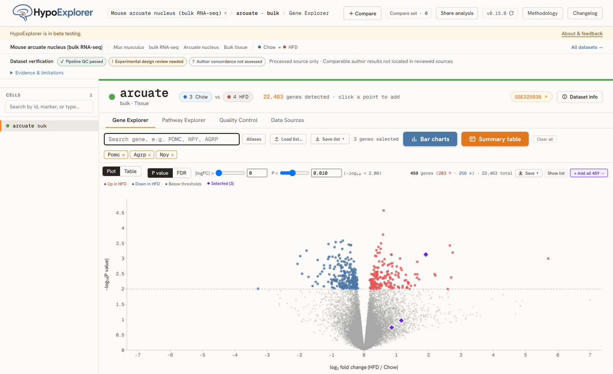
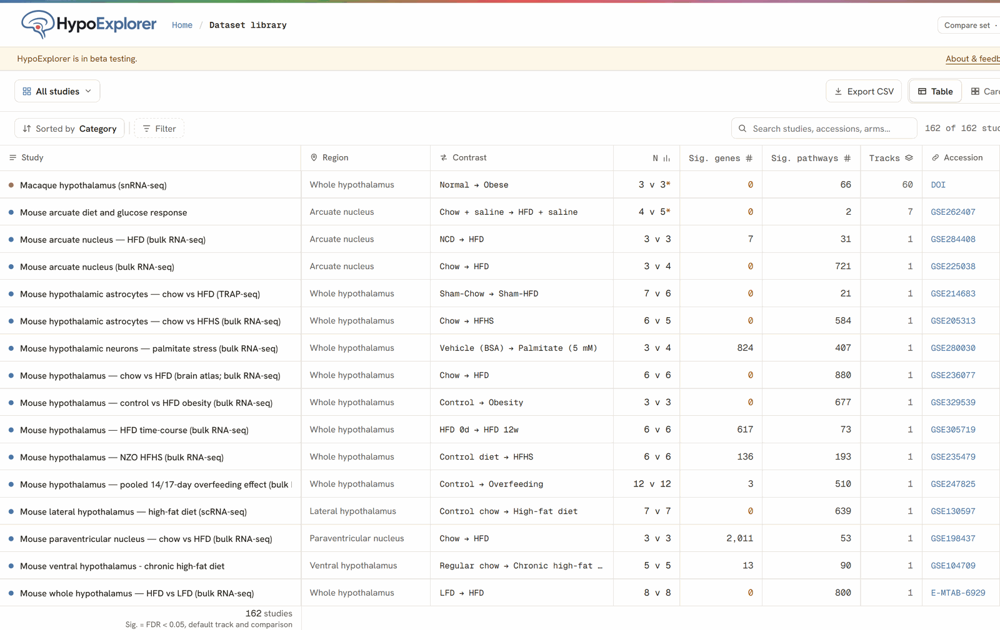

<p align="center">
  <a href="https://hypoexplorer.com"></a>
</p>

<h1 align="center">HypoExplorer</h1>

<p align="center">
  Where a gene is expressed in the hypothalamus, and how it changes across 162 public studies.
</p>

<p align="center">
  <a href="https://hypoexplorer.com"><strong>hypoexplorer.com</strong></a> ·
  <a href="https://hypoexplorer.com/methods/">Methods</a> ·
  <a href="https://hypoexplorer.com/how-to-cite/">How to cite</a> ·
  <a href="CHANGELOG.md">Changelog</a>
</p>

<p align="center">
  <a href="https://github.com/DrWenyuanHe/hypoexplorer/actions/workflows/application.yml"></a>
  <a href="https://github.com/DrWenyuanHe/hypoexplorer/actions/workflows/security.yml"></a>
  <a href="LICENSE"></a>
  
</p>

<p align="center">
  
</p>

HypoExplorer is a browser app for differential expression and pathway enrichment in
public hypothalamus transcriptomics. It covers 162 studies in 11 themes and 12
species, from a 60-population macaque snRNA-seq atlas to bulk RNA-seq and
microarray studies of diet, fasting, aging, hormones, circadian time and disease.
Every number belongs to one study and one comparison. The cross-study views
line studies up side by side and never pool them.

## What you can do

- **Look up a gene in one study.** Expression by group with each sample shown,
  a volcano plot with adjustable thresholds, and a summary table of log2FC,
  P and FDR. Searches resolve aliases and previous symbols through MGI, RGD
  and HGNC.
- **Browse pathways.** FGSEA results for GO, KEGG, Reactome and Hallmark (where a study has them), with
  leading-edge heatmaps and running enrichment curves.
- **Follow a gene or pathway across every study.** One report per gene or
  pathway, on a shared axis, with each study's own confidence interval.
- **Compare studies you pick.** Add up to 12 studies to a compare set. Each
  becomes a column, and the URL is a link you can share.
- **Survey baseline expression.** Expression by cell population, study condition
  and tissue, including the GTEx, HPA and Allen human references.
- **Check the evidence.** Each study shows separate badges for pipeline QC,
  experimental design and agreement with the original authors' results, with
  the checks and remaining limitations behind each one.
- **Export.** CSV, Excel and PNG exports carry the study, contrast, units and
  release identity, so a result can be traced back to its source.

<p align="center">
  
</p>

## Run it locally

You need [Node.js](https://nodejs.org) 22 or later. Corepack installs the pinned
[pnpm](https://pnpm.io).

```bash
corepack enable
pnpm install
pnpm run fetch:query        # query and tracker catalogs the app is built against
pnpm run fetch:expression   # optional: GTEx, HPA and Allen atlases (~230 MB)
pnpm dev                    # http://localhost:5173
```

The dataset bundles (about 1.2 GB) are not in this repository. The app reads them
from `https://data.hypoexplorer.com`. To run without it, `pnpm run data:offline`
restores them from the [data release](https://github.com/DrWenyuanHe/hypoexplorer-data)
and `pnpm run dev:offline` serves them locally; that copy has no KEGG results.
[The developer guide](docs/DEVELOPMENT.md) covers configuration, the checks CI
runs and what each folder holds.

## What is in this repository

This is the source of hypoexplorer.com: the React and TypeScript app, the dataset
registry, the bundle builders and analysis scripts, the static study pages, and
the Cloudflare Worker and edge rules that serve the site. Raw study downloads,
publisher supplements, KEGG-derived tables and the retained evidence ledgers stay
with the maintainer. Commands that rebuild data or replay evidence need those
inputs and do not run from a fresh clone.

## Citing HypoExplorer

Cite the original publication and the deposited dataset first, then HypoExplorer
for the interface and the analysis you used. The
[how-to-cite page](https://hypoexplorer.com/how-to-cite/) gives a suggested
reference, and [`CITATION.cff`](CITATION.cff) feeds GitHub's
**Cite this repository** button. Record the release identifier from your export,
so the exact build can be identified.

## Contributors

- **Wenyuan He**: creator and maintainer
- **Helene Li**: contributor

Questions, corrections and beta feedback: open an
[issue](https://github.com/DrWenyuanHe/hypoexplorer/issues) or write to
wenyuan.he@mail.utoronto.ca.

## License

The application code is MIT-licensed ([`LICENSE`](LICENSE)). The original studies,
data deposits and derived analysis outputs keep their own terms; see
[`REUSE.md`](REUSE.md) before reusing data or figures.

### Mouse HypoMap data

`pnpm run fetch:hypomap` installs and verifies the pinned browser export.
During release review, pass the candidate archive as a positional argument.
Offline development serves it from `public/hypomap`. Both HypoMap flags
(`VITE_HYPOMAP_EXPRESSION`, `VITE_HYPOMAP_COEXPRESSION`) stay off for hosted
builds for now. The data host's firewall rule
([`cloudflare/http_request_firewall_custom/hypoexplorer_data_paths.json`](cloudflare/http_request_firewall_custom/hypoexplorer_data_paths.json))
blocks `/hypomap/` and `.json`/`.gz` paths, and the site upload skips `*.gz`.
The atlas files are also read with `fetch()`, so the data host would need CORS
for the app origin. Hosted delivery needs those rules changed first.

The Spatial tab uses the same heatmap for every gene with HypoMap spatial data.
Its legend shows mean expression among detected cells in `ln(1 + counts per 10k)`.
The color range runs from zero to the highest mean among regions shown on the
coronal schematic for that gene. Selecting a region keeps that range fixed.
Separate swatches identify regions with no detected cells and regions with
unavailable data.
